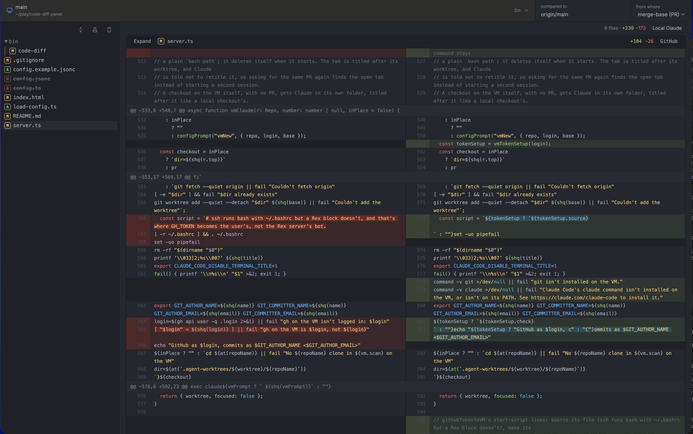

# paul's code review app
### An opinionated "hub" for an agent-first workflow



## Features

- Github like code-diff for local and remote server worktrees
   - live updating on code changes
- Pull requests switcher
    - quick switching between the repo's github PR's
    - cleaned up pull request overview
- Repo switcher
    - quick switching between repos on your local and remote server
- Claude session launcher
    - quick launch session on a remote server or locally
    - automatically pointed at existing worktrees
    - auto prompted to provide a full recap
- VSCode worktree launcher
    - edit existing or new code on a remote server or locally
- Ghostty, Rex (beta), Mac's Terminal support


## Human setup

```bash
claude "checkout https://github.com/paulcollett/pauls-code-review-app, setup and run dev server"
```


### Setup Details

Currently made for a Mac but could be adjusted for your OS
Made for [Node](https://nodejs.org) 24 or newer, `git`, and the [GitHub CLI](https://cli.github.com) (`gh`, logged in with `gh auth login`)

```sh
npm ci
cp config.example.jsonc config.jsonc   # then set "scan" to the folders your repos live in and prompt user for other config
```
